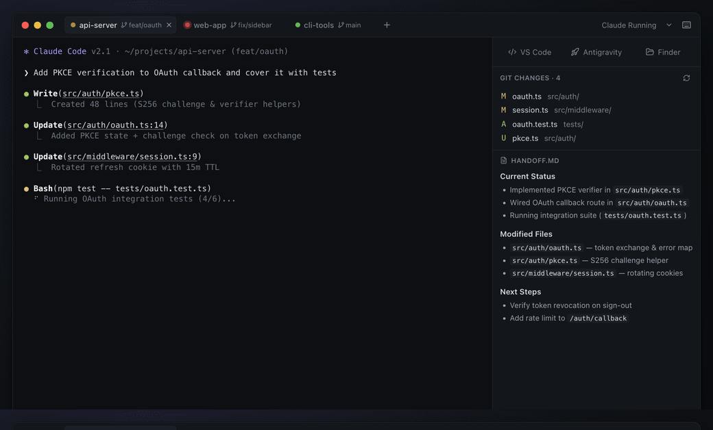

# Argus

[繁體中文](README.zh-TW.md)

A terminal workspace for coding agents on macOS. Keep every project in its own tab, run Claude Code, Antigravity CLI (`agy`) or Codex in it, and see at a glance which agent is working, which one is waiting for you, and which one is done.



## Features

- **Status lights on every tab**: running (pulsing yellow), waiting for your confirmation (red), done (green). You don't need to switch tabs to know who needs you.
- **One launcher for several agents**: start or resume Claude Code, `agy` or Codex from the tab bar. If the tab is busy, the chosen agent opens in a new tab for the same folder instead of interrupting the current one.
- **Project sidebar**: live Git changes, and the project's `HANDOFF.md` (or `CLAUDE.md`) rendered as it is updated.
- **Handoff protocol**: one click adds rules to the project's `CLAUDE.md` so the agent keeps `HANDOFF.md` up to date. When you switch agents or people, the next one can pick up where the last one stopped.
- **Several tabs per project**: same folder, or a new Git worktree so two agents don't overwrite each other (⌘⇧T).
- **Open the project in VS Code, Antigravity or Finder**. Editors that aren't installed are shown with a link to their download page.
- **⌘-click file paths in the terminal**: code and text files open in VS Code or Antigravity at the right line (`src/App.tsx:313`), other files in their default app. ⌘⌥-click reveals the file in Finder. Apps, scripts and installers are never run from a click.
- **macOS editing keys in the terminal**: ⌘← / ⌘→ for line start/end, ⌥← / ⌥→ by word, ⌘⌫ to delete to line start, ⇧↩ for a newline in Claude Code.
- **Keyboard first**: ⌘K project and action switcher, ⌘1–9 to jump to a tab, ⌘/ for all shortcuts.

## Agent support

|                                 | Claude Code | agy | Codex                          |
| ------------------------------- | ----------- | --- | ------------------------------ |
| Start / resume from the tab bar | ✓           | ✓   | ✓                              |
| Running and done lights         | ✓           | ✓   | –                              |
| Waiting-for-you light           | ✓           | –   | best effort (from screen text) |
| New chat / switch chat buttons  | ✓           | –   | –                              |

The interface follows your macOS language: Traditional Chinese or English.

## Install

Download the latest `Argus_*.dmg` from [Releases](https://github.com/Liang515/argus/releases), open it and drag Argus into Applications. The app is signed and notarized by Apple, so it opens normally.

Requirements:

- macOS on Apple Silicon or Intel.
- zsh as your shell (the macOS default) for the status lights.
- At least one agent: [Claude Code](https://code.claude.com/docs/en/setup), [Antigravity CLI](https://antigravity.google/docs/cli/install) or [Codex](https://developers.openai.com/codex/cli/). Argus shows install links for the ones you don't have and picks them up as soon as they are installed.

## What Argus writes on your machine

Argus never edits your own shell or agent settings. It writes only:

- `~/.argus/`: saved tabs, the Claude Code status hook, and a zsh wrapper that loads your normal zsh config and then adds the hook to `claude` inside Argus tabs only.
- `~/.gemini/config/plugins/argus/`: a status plugin for `agy`, only if `agy` is installed. It does nothing outside Argus.
- `CLAUDE.md` in a project, only when you click "add handoff rules" in the sidebar.
- A sibling folder `<project>-wt-N`, only when you open a tab as a new Git worktree.

## Build from source

Requires Node.js 20+, Rust (stable) and the Xcode Command Line Tools.

```sh
npm ci
npm run tauri dev     # run in development
npm run tauri build   # build Argus.app and a .dmg
```

Builds are ad-hoc signed by default. To sign with your own certificate, set `APPLE_SIGNING_IDENTITY` before building.

Checks: `npm run lint`, `npm run typecheck`, `npm test`, and in `src-tauri/`: `cargo fmt --check`, `cargo clippy --all-targets`, `cargo test`.

## Contributing

Issues and pull requests are welcome. Please run the checks above before opening a pull request.

## License

[MIT](LICENSE)
