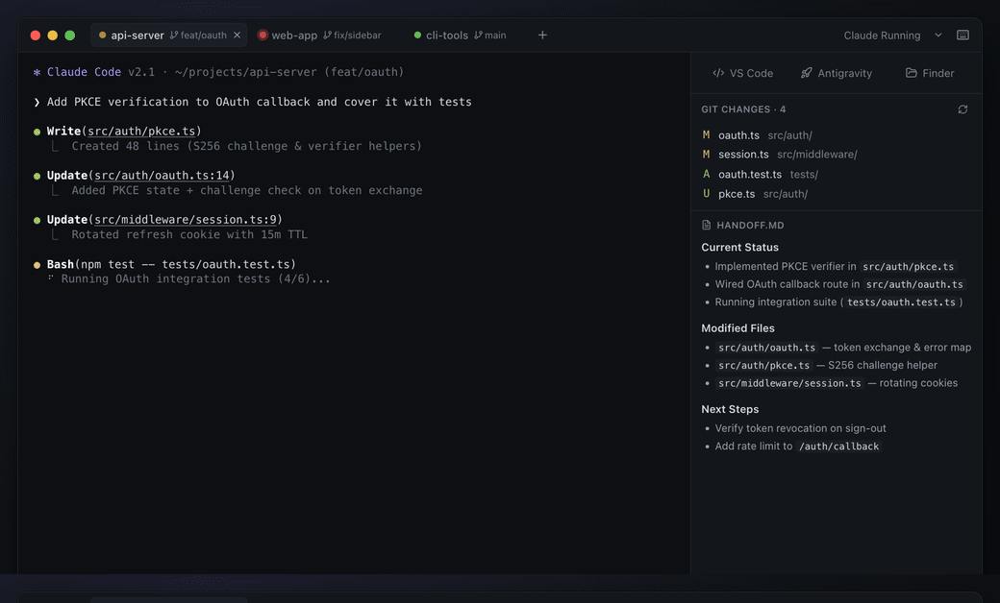

# Argus

[English](README.md)

給 coding agent 用的 macOS 終端機工作區。每個專案一個分頁，在裡面跑 Claude Code、Antigravity CLI（`agy`）或 Codex，一眼看出哪個 agent 正在工作、哪個在等你確認、哪個已經完成。



## 功能

- **每個分頁都有狀態燈**：執行中（黃色閃爍）、等你確認（紅色）、已完成（綠色）。不用切過去就知道誰需要你。
- **一個啟動器管多個 agent**：從分頁列啟動或接續 Claude Code、`agy`、Codex。分頁被占用時，選的 agent 會在同資料夾的新分頁開，不會打斷原本的。
- **專案側欄**有三個小分頁：**活動**（Claude 的計畫進度條，以及 Claude／`agy` 的每一步：讀了哪些檔、改了幾行、執行的指令成功或失敗與花費時間）、**變更**（即時 Git 狀態）、**交接**（專案裡的 `HANDOFF.md` 或 `CLAUDE.md`）。
- **交接規則**：一鍵在專案的 `CLAUDE.md` 加上規則，讓 agent 隨時更新 `HANDOFF.md`。換 agent 或換人時，下一個能從上一個停下的地方接手。
- **同專案多分頁**：同一個資料夾，或新的 Git worktree，兩個 agent 不會互相覆蓋（⌘⇧T）。分頁名稱維持清楚，放不下時有「全部分頁」選單，畫面外的分頁在等你時會亮燈提醒。
- **用 VS Code、Antigravity 或 Finder 開啟專案**。沒安裝的編輯器會顯示下載連結。
- **在終端機裡 ⌘＋點擊檔案路徑**：程式碼與文字檔用 VS Code 或 Antigravity 打開並跳到指定行（例如 `src/App.tsx:313`），其他檔案用系統預設的 App。⌘⌥＋點擊在 Finder 顯示。.app、腳本、安裝檔不會因為點擊而被執行。
- **終端機裡也能用 macOS 編輯鍵**：⌘← / ⌘→ 到行首／行尾、⌥← / ⌥→ 跳一個字、⌘⌫ 刪到行首、⇧↩ 在 Claude Code 裡換行。
- **鍵盤優先**：⌘K 切換專案與動作、⌘1–9 跳到分頁、⌘/ 看所有快捷鍵。
- **配色**：Argus、Clear Dark，或跟隨 macOS「終端機」的配色（⌘K 搜尋「配色」）。
- **自動更新**：有新版時分頁列會出現「新版」按鈕，點一下就下載、安裝並重開。
- **輕鬆安裝 agent**：沒裝的 agent 會顯示官方安裝指令，可以直接在新分頁執行。

## 各 agent 支援程度

|                      | Claude Code | agy       | Codex                  |
| -------------------- | ----------- | --------- | ---------------------- |
| 從分頁列啟動／接續   | ✓           | ✓         | ✓                      |
| 執行中、已完成燈號   | ✓           | ✓         | –                      |
| 等你確認燈號         | ✓           | –         | 盡量偵測（看畫面文字） |
| 新對話／切換對話按鈕 | ✓           | –         | –                      |
| 活動面板             | ✓           | ✓（動作） | –                      |

介面語言跟著 macOS 系統語言：繁體中文或英文。

## 安裝

從 [Releases](https://github.com/Liang515/argus/releases) 下載最新的 `Argus_*.dmg`，打開後把 Argus 拖進「應用程式」。App 已經過 Apple 簽名與公證，雙擊就能直接打開。

需求：

- macOS（Apple Silicon 或 Intel）。
- 狀態燈需要 shell 是 zsh（macOS 預設）。
- 至少一個 agent：[Claude Code](https://code.claude.com/docs/en/setup)、[Antigravity CLI](https://antigravity.google/docs/cli/install) 或 [Codex](https://developers.openai.com/codex/cli/)。沒裝的 Argus 會顯示安裝連結，裝好後就能直接用。

## Argus 會在你的電腦寫入什麼

Argus 不會改你自己的 shell 或 agent 設定，只會寫入：

- `~/.argus/`：存下的分頁、Claude Code 狀態 hook，以及 zsh 包裝：先照常載入你的 zsh 設定，再只在 Argus 分頁裡替 `claude` 加上 hook。
- `~/.gemini/config/plugins/argus/`：`agy` 的狀態外掛，只有裝了 `agy` 才會寫，在 Argus 以外不做任何事。
- 專案的 `CLAUDE.md`：只有你在側欄按「加入交接規則」時才會寫。
- 專案旁邊的 `<專案>-wt-N` 資料夾：只有你選擇用新的 Git worktree 開分頁時才會建立。

## 從原始碼 build

需要 Node.js 20 以上、Rust（stable）與 Xcode 命令列工具。

```sh
npm ci
npm run tauri dev     # 開發模式執行
npm run tauri build   # 產生 Argus.app 與 .dmg
```

預設用 ad-hoc 簽名。要用自己的憑證簽名，build 前設定環境變數 `APPLE_SIGNING_IDENTITY`。自動更新用的檔案（`.app.tar.gz` 與簽名）只在發版流程產生，自己 build 不需要簽名金鑰。

檢查：`npm run lint`、`npm run typecheck`、`npm test`，以及在 `src-tauri/` 裡的 `cargo fmt --check`、`cargo clippy --all-targets`、`cargo test`。

## 參與貢獻

歡迎開 issue 或送 pull request。送 PR 前請先跑過上面的檢查。

## 授權

[MIT](LICENSE)
